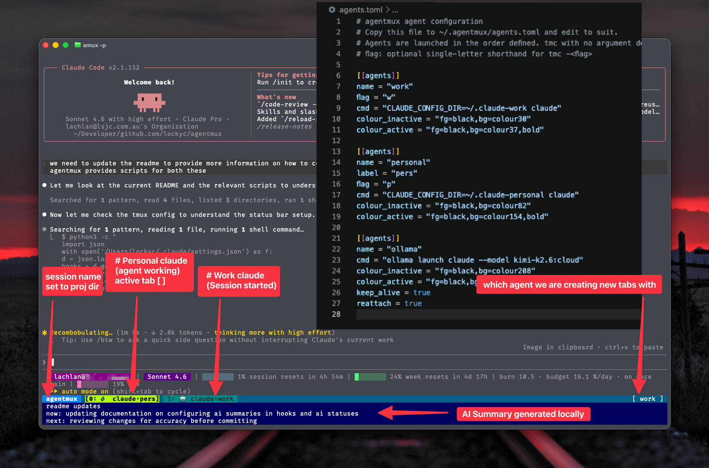
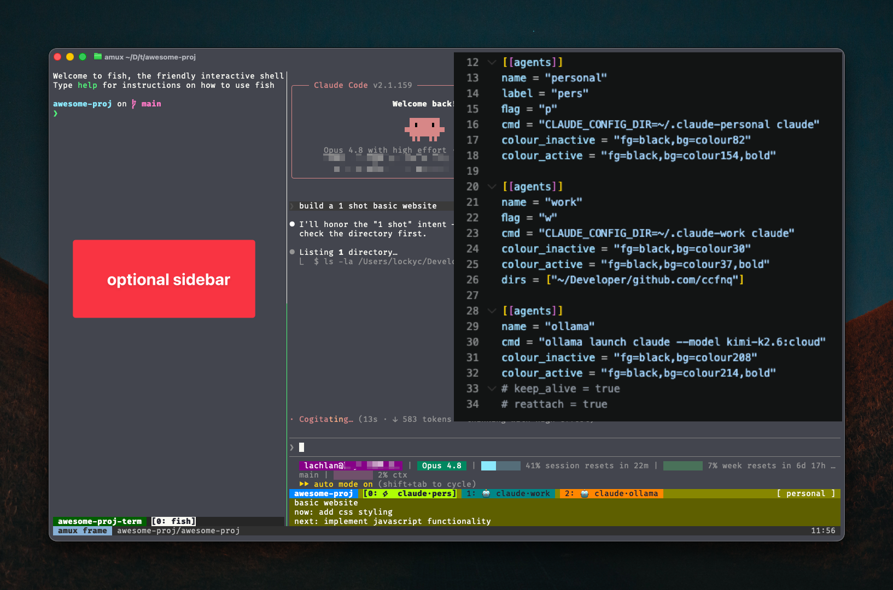

# agentmux

[](https://github.com/lockyc/agentmux/releases/latest)


[](LICENSE)

> **Dormant.** agentmux still works and stays published, but it isn't under active development. Its author now keeps each project's coding agents in [warden](https://github.com/lockyc/warden), a terminal app that holds them in sessions on a Rex server (Superlogical's server-side terminal multiplexer) instead of tmux.

Run your coding agents — or any CLI — in tmux sessions defined in one TOML file. Each session launches the right agent for its directory, tabs are colour-coded per agent and show what each one is doing, and `prefix m` cycles through them. `amux @host` runs the session on a [remote machine](#remote-sessions); your laptop only carries the connection.





## Install

```bash
curl -fsSL https://raw.githubusercontent.com/lockyc/agentmux/main/install.sh | bash
```

This clones agentmux into `~/.agentmux/` (a git clone — update later with
`amux --update`). You can also clone the repo and run `bash install.sh` directly.

Then complete the setup:

**1. Install dependencies** (if not already present):
```bash
which toml2json || brew install toml2json
which jq        || brew install jq
```

**2. Add to your shell config:**

bash/zsh (`~/.zshrc` or `~/.bashrc`):
```bash
source ~/.agentmux/shell/agentmux.sh
```

fish (`~/.config/fish/config.fish`):
```fish
source ~/.agentmux/shell/agentmux.fish
```

**3. Edit `~/.agentmux/amux.toml`** to define your agents (created from the example by the installer).

**4. Reload your shell:**
```bash
source ~/.zshrc                  # or restart your shell
```

**5. Launch your first session:**
```bash
amux
```

## Prerequisites

- tmux >= 3.6
- `toml2json`: `brew install toml2json`
- `jq`: `brew install jq`
- A local OpenAI-compatible LLM endpoint (optional — for AI summary status lines; e.g. LM Studio, Ollama)
- `reattach-to-user-namespace` (optional, macOS — only if using `reattach = true` in amux.toml)
- A notification-aware host terminal (optional — for `--notify` alerts; the hook emits a standard OSC 777 desktop-notification escape, surfaced by hosts like [warden](https://github.com/lockyc/warden) or Ghostty)

Working *on* agentmux additionally wants `shellcheck` and `expect` — see [Development](#development).

## Usage

agentmux is driven two ways: **`amux …` shell commands** you type at a prompt to launch and manage sessions, and **tmux key bindings** you press once you're inside a session. Never used tmux? Read [Inside a session: tmux basics](#inside-a-session-tmux-basics) first — you don't need to know tmux going in.

### amux commands

Normal shell commands — type them at a prompt.

| Command | Effect |
|---|---|
| `amux` | New/attach session; agent auto-selected from the current directory (see below), else the first agent in the list |
| `amux -<flag>` | New/attach session, agent matching flag (e.g. `-w` for `flag = "w"`) |
| `amux <agent>` | New/attach session, agent by name |
| `amux <agent> <session>` | New/attach named session with specified agent |
| `amux --sessions` | List agentmux agent sessions (name, agent, windows, attach state) |
| `amux --sessions-json` | The same, as JSON keyed on project **directory** rather than name — always valid JSON (`[]` when nothing is running). For scripting |
| `amux attach <name>` | Attach to a running agent session by name, from any directory |
| `amux @<host> [project]` | Launch/attach a session on a remote host from `[[hosts]]` — see [Remote sessions](#remote-sessions) |
| `amux --restore [--global]` | Pick dropped agent tabs (lost to a crash/reboot) to relaunch — this project by default, `--global` for all. Lands you exactly where a bare `amux` would: in a frame if this project sets `[frame] default = true` (`amux --no-frame --restore` opts out). Also offered automatically when you launch `amux` in a project with dropped tabs — that offer stands until you actually answer it, so closing the window at the prompt doesn't consume it |
| `amux --probe [session]` | Exit 0 if a session exists — the agent **or** a lingering frame (default: current dir). Silent; for scripting a presence indicator off the exit code (warden shows one as a dot on each tab). With no `session` arg it matches only the session launched *from this dir*, and exits **3** if there's no live session but a crashed one here is restorable (a plain `amux` would offer the restore picker); **1** if there's nothing at all. An explicit `session` arg is a plain 0/1 presence check. Because 3 is non-zero, a shell `if amux --probe` treats a restorable session as absent |
| `amux --kill [session]` | Kill an agent session **and** its frame + terminal (default: current dir). Like `--probe`, the no-arg form only reaps the session launched *from this dir* — a same-named sibling project is left alone. The no-arg form also discards this dir's pending crash-restore offer, so `--probe` stops exiting 3 (the tabs stay reachable via `amux --restore`) |
| `amux --suspend [session]` | `--kill`, but restorable: the agent tabs stay recorded as open, so `--probe` exits 3 and the next bare `amux` here offers them in the restore picker. For pausing a project to free its processes without losing its conversations |
| `amux --kill-all` | Kill every agent session + all frames/terminals (asks first) |
| `amux --update` | Update to the latest agentmux (`git pull --ff-only` of `~/.agentmux`) |
| `amux --reload` | Re-source the tmux config on every running agent session at once — apply a pulled `agent.conf`/`agentmux.conf` change (e.g. after `amux --update`) to servers already up; fresh launches pick it up automatically |
| `amux --colours [grid\|names\|pick]` | Preview the colour palette: `grid` (curated names + 256 codes) or `names` (the raw palette-name list). `pick [agent]` interactively builds a paste-ready `colour =` line |
| `amux --frame [agent] [session]` | Side-terminal layout: bare shell (left) + amux (right) as a nested tmux |
| `amux --no-frame` | One-off plain launch when `[frame] default = true` is set (skips the frame) |
| `amux --term [session]` | Attach (or create) this project's persistent scratch terminal **on its own**, without the frame around it — the same terminal a frame's left column shows, top-region shells included. Use it when your terminal app makes its own split: `amux --term` in one pane, `amux --no-frame` in the other. A frame and a `--term` pane share one scratch column. Reaped by `--kill`; ignored by `--probe` |
| `amux --frames` | List active `--frame` wrappers |
| `amux --frame-kill [session]` | Tear down a frame (wrapper + its left terminal) — or a frame-less scratch terminal started by `--term`; the agent keeps running |
| `amux --frame-kill-all` | Tear down ALL frames + scratch terminals at once; agents keep running |
| `amux --version` | Print the installed agentmux version |
| `amux --help` | Print usage |

Set `[update] check = true` in `~/.agentmux/amux.toml` to enable a once-daily
check that notifies (notify-only) when a newer agentmux is available on GitHub.

Sessions are named after `basename $PWD` (every character outside `A-Za-z0-9_-` — spaces, slashes, colons, dots, … — becomes `_`) by default — run `amux` in your project directory and it picks up the name automatically. Pass an explicit name with `amux <agent> <session>` to override. Run `amux` from a plain terminal: it refuses to start inside an existing tmux. agentmux sessions get a coloured status bar, AI summary rows, and tab-state emojis; plain tmux sessions are left unstyled.

### Inside a session: tmux basics

`amux` launches your agent inside **tmux**, which keeps the session running in the background — even if you close the terminal window. You drive tmux with a handful of keyboard shortcuts; here's everything you need, no prior tmux knowledge assumed.

**Reading the shortcuts.** `C-b` means *hold Ctrl and tap `b`*. Likewise `C-f` is Ctrl+f. That's the whole notation.

**The prefix.** tmux can't act on its shortcuts directly — they'd collide with the program running inside (your agent wants Ctrl+C, Ctrl+R, and so on for itself). So you first press a **prefix** key to get tmux's attention, *release it*, then press the command key. The default prefix is **`C-b`** (Ctrl+b). When you see `prefix c`, it means: press Ctrl+b, let go, then press `c`. To use a different key for amux sessions, set `[amux] prefix` (e.g. `prefix = "C-a"`) — it applies only to amux's own sessions, not your other tmux work. It can be overridden per-directory with an `[amux.dirs."<path>"]` block, exactly like `[frame.dirs]` (see [Side-terminal layout](#side-terminal-layout---frame)).

**The three keys you'll actually use** — each pressed after the prefix:

- **`c`** — **c**reate a new tab (auto-launches the current agent)
- **`x`** — close the current tab (e**x**it)
- **`d`** — **d**etach: leave everything running in the background and drop back to your shell

**Detaching** is how you step away without stopping the agent. Press `prefix d` (Ctrl+b, then `d`) and your agent keeps working; re-run `amux` in the same directory to reattach. Closing the terminal window detaches too — it never kills the session. (Inside a `--frame` the prefix is `C-f`, so you detach with `C-f d` — see [Side-terminal layout](#side-terminal-layout---frame).)

### tmux key bindings

All of these are pressed **after the prefix** (`C-b` by default).

| Press | Effect |
|---|---|
| `prefix c` | New tab — auto-launches the currently selected agent (see `prefix m`) |
| `prefix x` | Close the current tab. On an agentmux session's last tab it opens a fresh agent tab first (as `prefix c` would), so the session survives; everywhere else it's tmux's kill-pane |
| `prefix d` | Detach — leave the session running and return to your shell |
| `prefix m` | Cycle the selected agent through your defined agents (agentmux sessions only) |
| `prefix f` | Fork this tab's agent session into a new tab beside it — the new tab resumes the same conversation as an independent branch, leaving the original untouched, with nothing to type. On an agent tab with no session yet (or an agent that can't fork) it says so and does nothing. Outside agentmux sessions the key keeps tmux's default, `find-window` |
| `prefix v` | Clear the state emoji (✅/📣/⚡…) off the current tab. One-shot — the next status hook re-adds one as normal; use it to acknowledge a done/notify tab. No-op on a tab with no emoji |
| `prefix N` | Toggle this tab's three summary rows between the AI summary and notes 1-3. In notes mode, **click any of those rows** to edit it — the prompt opens prefilled with that row's current text (Enter commits, Escape cancels, an empty commit clears it). While the AI summary is showing, rows 1-3 are click-inert (a click does nothing) — press `prefix N` first. The optional fourth row (see [The always-on note row](#the-always-on-note-row)) is unaffected by this toggle and clickable either way. Notes are per-tab and live in memory: closing the tab (`prefix x`), a crash, `amux --kill`, or a reboot drops them. The AI summary keeps updating underneath, so toggling back shows a current one |

### Customizing tmux (per-role overlays)

agentmux runs each agent — and, under `--frame`, the wrapper and scratch terminal —
on its **own** tmux server that does **not** read your `~/.tmux.conf`; it sets its own
defaults (escape-time, focus-events, scrollback, mouse, clipboard). Your own `~/.tmux.conf` needs no
agentmux line. Adding `source-file ~/.agentmux/tmux/agentmux.conf` there is only for
running Claude in plain tmux outside amux (tab states, notifications), and it installs
amux's hooks and `prefix v`/`prefix N` bindings on that regular server.

To add **your own** tmux settings on top — vi copy-mode, custom bindings, a different
status style — drop them in an optional **per-role** overlay, each loaded **last** by
that role's tmux server so your settings win. There are three, one per surface, and they are **not
shared**:

| Overlay | Applies to |
|---|---|
| `~/.agentmux/user.agent.tmux.conf` | the agent pane (what most people want) |
| `~/.agentmux/user.frame.tmux.conf` | the `--frame` wrapper |
| `~/.agentmux/user.term.tmux.conf` | the `--frame` scratch terminal |

```bash
cp ~/.agentmux/config/user.tmux.conf.example ~/.agentmux/user.agent.tmux.conf
# edit it, then:
amux --reload        # applies the agent overlay to running agent servers
```

You only need a file if you want to customize that role — an absent overlay changes
nothing. Prefer copying the specific bindings/options you want rather than `source`-ing
a full `~/.tmux.conf` that loads plugins (plugin loading stalls every launch). See the example file's header for the full caveats, including how
to share common settings across roles.

### Directory-based agent selection

Give an agent a `dirs` list and a bare `amux` (no flag, no agent name) auto-selects it based on the current directory — no flag or `prefix m` toggle needed:

```toml
[[agents]]
name = "work"
cmd  = "CLAUDE_CONFIG_DIR=~/.claude-work claude"
dirs = ["~/work", "~/clients"]
```

A pattern matches when `$PWD` is that directory or any subdirectory of it (`~/work` covers `~/work/acme/api`). `~` expands to `$HOME`. When more than one agent matches, the longest (most specific) path wins, so you can nest a specific rule inside a broader one. If nothing matches, `amux` falls back to the first agent in the list. An explicit `-<flag>` or `<agent_name>` argument always overrides directory routing.

Matching uses the logical path — `$PWD` as your shell shows it — and symlinks are **not** resolved. Write patterns the way you actually `cd` into the directory (e.g. via the symlink path, not its target).

### Side-terminal layout (`--frame`)

`amux --frame [agent] [session]` puts a persistent scratch terminal in the left
pane beside amux on the right. The frame has its own prefix, `C-f`: `C-f h`/`l`
switch sides, `C-f d` detaches, `C-f Q` quits the frame and leaves the agent
running. Layout keys, nesting, per-directory overrides and managing frames:
[docs/frame.md](docs/frame.md).

## Remote sessions

`amux @<host>` launches or attaches an agent session on a remote machine, defined in `~/.agentmux/amux.toml`:

```toml
[[hosts]]
name  = "buildbox"                        # what you type after @
ssh   = "root@buildbox"                   # ssh target or ~/.ssh/config alias
roots = ["~/Developer/work", "~/src"]     # searched for <project>; ~ expands on the REMOTE
transport = "ssh"                         # ssh (default) | et | mosh
agent = "work"                            # optional: agent to pass to the remote amux
```

There is no `user`/`port`/`key`/`password` field: `ssh` names an ssh target or a `~/.ssh/config` `Host` alias. If `ssh buildbox` works, `amux @buildbox` works.

Four invocation forms:

| Command | Effect |
|---|---|
| `amux @buildbox` | Pick a project from a list of everything under that host's `roots` (a live session shows a filled dot and its tab count; an idle one a hollow dot) |
| `amux @buildbox myproject` | Launch/attach `myproject` on buildbox directly, no picker |
| `amux @buildbox:~/tmp/scrap` | An explicit remote path, skipping `roots` resolution entirely |
| `amux @buildbox myproject --kill` | Any flag after a named project forwards to the *remote* amux — so this kills `myproject`'s session on buildbox, not locally |

**Everything runs on the remote**: the tmux servers, the agent process, the session log, the AI summaries. Your local machine is transport only, so closing the laptop costs you a re-attach — `amux @buildbox myproject` again — never work in flight. If the link drops mid-session, agentmux shows a holding screen ("reconnecting — attempt N, MM:SS elapsed… your session is still running on buildbox; nothing is lost") and retries with backoff; `q` gives up without touching the remote session, and the message it prints names the exact command to get back in.

Like a plain launch, `amux @host` refuses to run from inside an existing tmux — a remote session brings its own tmux, and nesting stacks prefixes.

**Transports**, set per host with `transport =`:
- **`ssh`** (default) — stock, multiplexed (`ControlMaster`), full escape transparency. The right default for most links.
- **`et`** (Eternal Terminal) — a transparent byte stream with its own automatic reconnect/roaming. Needs `et` installed locally and `etserver` on the remote.
- **`mosh`** — for genuinely bad links; desktop notifications (OSC 777), OSC 52 clipboard and tmux passthrough don't work over it. agentmux warns once per host when you use it; prefer `ssh` or `et` unless the link needs it.

Nothing new to install locally for the default `ssh` transport. On the remote, if agentmux isn't found, `amux @host` offers to install it (the same `curl | bash` from [Install](#install)) before continuing — an offer you can decline.

## Adding an agent

Add a new `[[agents]]` block to `~/.agentmux/amux.toml`:

```toml
[[agents]]
name = "myagent"
flag = "a"
cmd = "my-ai-cli"
colour = "green"
```

`colour` is a curated palette name (run `amux --colours` to preview them) or a 256
code like `"colour82"`/`"82"` — agentmux derives the active and inactive tab shades
from it automatically. Run `amux --colours pick myagent` to choose one interactively
and get a paste-ready line. For full manual control, skip `colour` and set the raw
tmux styles instead (see [the `[[agents]]` table](docs/config.md#agents--one-block-per-agent)).

The new agent appears in the `prefix m` cycle immediately (no reload needed).

## Configuration reference

Every key `~/.agentmux/amux.toml` reads, with defaults and env overrides:
[docs/config.md](docs/config.md). `config/amux.toml.example` is the annotated tour.

## Adding an agent integration

`amux` and friends launch any CLI from `amux.toml`. The richer integration — tab-state emojis and the AI summary status lines — runs through a per-agent **adapter** at `scripts/<agent>/status.sh`; the shipped Claude Code adapter (`scripts/claude/`) is the reference. The adapter contract, and how to keep your own adapters outside the clone: [docs/integration.md](docs/integration.md).

## Shell support

`amux` works in **bash**, **zsh**, and **fish**. **bash must be installed**, but it does not have to be your interactive shell.

| Shell | `amux` command | Tab-completion | Integration file | Source from |
|---|---|---|---|---|
| bash | ✓ | — | `shell/agentmux.sh` | `~/.bashrc` |
| zsh | ✓ | ✓ | `shell/agentmux.sh` | `~/.zshrc` |
| fish | ✓ | ✓ | `shell/agentmux.fish` | `~/.config/fish/config.fish` |

Where completion is wired, the first argument completes agent names and `-<flag>` shortcuts (`amux --complete`) plus `@host` tokens (`amux --complete-hosts`); the second completes a remote project after `@host` (`amux --complete-remote <host>`, from the local cache) or a live session name after `--kill`, `--suspend`, `--frame-kill`, `--probe`, or `attach` (`amux --complete-sessions`). Each prints one candidate per line. (bash gets the command without completion; nothing stops you adding a `complete` script for it.)

Adding another shell (nushell, elvish, xonsh) is a few-line wrapper: [docs/integration.md](docs/integration.md#adding-another-shell).

## AI tab states (Claude Code)

The `claude/status.sh` hook drives an emoji on the tmux tab label reflecting Claude's current state:

| Emoji | State |
|---|---|
| 🤖 | Session started |
| ⚡ | Working |
| 🔐 | Awaiting permission |
| 📣 | Waiting for input |
| ✅ | Done |

**Setup:** the clone includes `scripts/claude/`; wire the hooks in `~/.claude/settings.json`:

```json
{
  "hooks": {
    "SessionStart":      [{ "hooks": [{ "type": "command", "command": "~/.agentmux/scripts/claude/status.sh start" }] }],
    "UserPromptSubmit":  [{ "hooks": [{ "type": "command", "command": "~/.agentmux/scripts/claude/status.sh working" }] }],
    "PostToolUse":       [{ "hooks": [{ "type": "command", "command": "~/.agentmux/scripts/claude/status.sh working" }] }],
    "Notification":      [{ "hooks": [{ "type": "command", "command": "~/.agentmux/scripts/claude/status.sh notify" }] }],
    "PermissionRequest": [{ "hooks": [{ "type": "command", "command": "~/.agentmux/scripts/claude/status.sh permission --notify 'Claude is waiting for permission'" }] }],
    "Stop":              [{ "hooks": [{ "type": "command", "command": "~/.agentmux/scripts/claude/status.sh done --notify 'Claude has finished working'" }] }]
  }
}
```

The `--notify` flag emits a standard **OSC 777 desktop-notification** escape *through the terminal*, including from inside a `--frame`. A notification-aware host such as [warden](https://github.com/lockyc/warden) ties the alert to the agent's own tab (badge + macOS banner); plain Ghostty raises a system notification. A host that doesn't understand OSC 777 simply ignores it. Remove `--notify` if you don't want alerts.

## AI summary status lines

Three summary rows under the status bar show a rolling `done / now / next` summary of the active session. It needs a local LLM endpoint and the Claude Code hooks above.

**Requirements:**
- A local OpenAI-compatible LLM endpoint with a small non-reasoning instruct model loaded (e.g. LM Studio at `localhost:1234` with `qwen2.5-14b-instruct`, or Ollama at `localhost:11434`)
- Claude Code hooks wired (above) — the `working` hook triggers the summariser

The coloured status bar and 3 extra summary rows only appear in `amux` sessions. Plain tmux sessions are left unstyled with a single status line.

On every `working` hook, agentmux digests the transcript in the background and asks the endpoint for a `<subject>. done: …; now: …; next: …` line. If a refresh fails, the last good rows stay.

Override the endpoint or model with environment variables:

```bash
export AGENTMUX_LLM_URL=http://localhost:1234/v1/chat/completions
export AGENTMUX_LLM_MODEL=qwen2.5-14b-instruct
export AGENTMUX_LLM_TIMEOUT=45   # seconds
```

**Non-Claude agents:** any agent can participate by pushing the three rendered rows into its pane's `@amux_row1/2/3` options. Render each row from your summary line with `summary_rows.sh --stdin <row>`, set the option on your own pane, and refresh:

```sh
summary="…"   # "<subject>. done: …; now: …; next: …"
for r in 1 2 3; do
  tmux set-option -p -t "$TMUX_PANE" "@amux_row$r" \
    "$(printf '%s' "$summary" | ~/.agentmux/scripts/summary_rows.sh --stdin "$r")"
done
tmux refresh-client -S
```

The format is a single line: `<subject>. done: <text>; now: <text>; next: <text>` — any of the `done`/`now`/`next` labels may be omitted.

### The always-on note row

`[notes] row = true` adds a fourth status row that keeps a per-tab note on
screen whatever rows 1-3 show; click it to edit. Details:
[docs/config.md](docs/config.md#the-always-on-note-row).

## Session colours

Each session's status-bar colour comes from its name. Pin a project's colour
with `session_colour` in an `[amux.dirs."<path>"]` block:
[docs/config.md](docs/config.md#session-colours).

## Development

Needs `shellcheck` and `expect` (neither is needed to use agentmux).

```sh
just gate               # shellcheck + the test suite (test.sh)
bash tests/mouse/run.sh # status-bar click tests (expect-driven pty)
just bench              # presence-probe timing (ledger miss vs hit)
```
