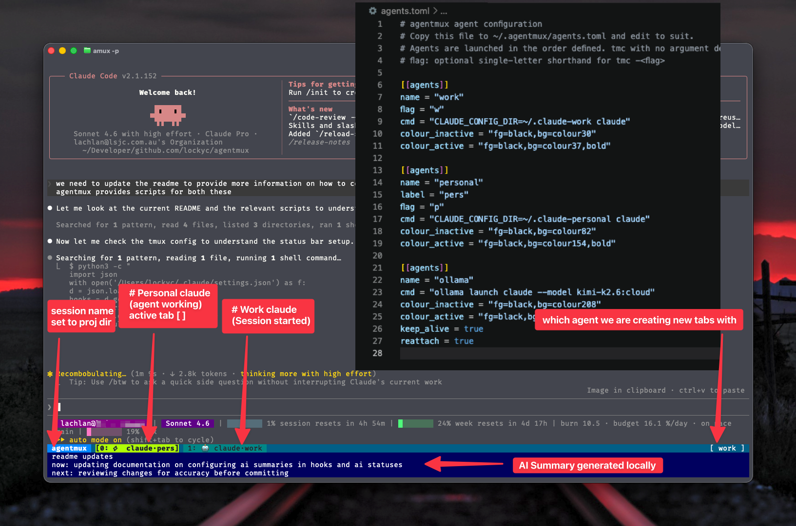
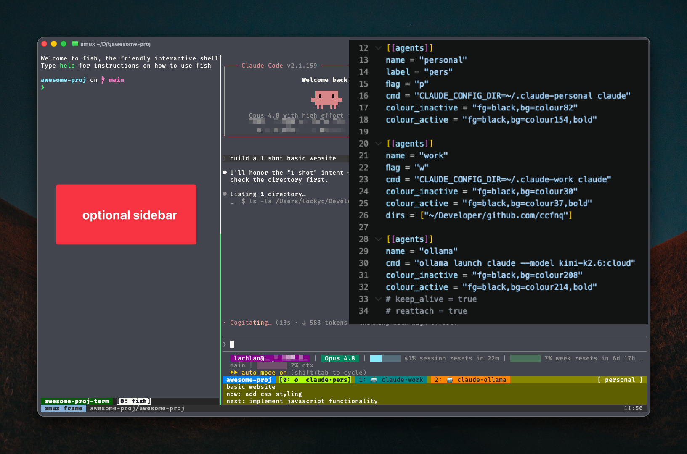

# agentmux

[](https://github.com/lockyc/agentmux/releases/latest)


[](LICENSE)

Configurable tmux agent launcher. Define AI agents (or any CLI) in TOML; sessions auto-launch the correct agent, tabs are colour-coded per agent, and `prefix m` cycles through the list. `amux @host` runs the session on a [remote machine](#remote-sessions); your laptop only carries the connection.





> **Companion project: [warden](https://github.com/lockyc/warden)** — a notification-aware terminal built for this workflow. agentmux's `--notify` hook emits a standard OSC 777 escape *through* tmux; warden surfaces it as a per-tab badge plus a macOS banner tied to the agent that raised it (see [AI tab states](#ai-tab-states-claude-code)). agentmux works in any terminal — warden just makes the notifications first-class.

## Install

### Claude Code (interactive — recommended)

Clone the repo, open it in Claude Code, and run:

```
/agentmux:install
```

The command checks dependencies, runs the installer, and interactively wires your shell config and Claude Code hooks. It then self-installs to `~/.claude/commands/` so `/agentmux:install` is available globally for future updates from any directory.

### Manual

```bash
curl -fsSL https://raw.githubusercontent.com/lockyc/agentmux/main/install.sh | bash
```

This clones agentmux into `~/.agentmux/` (a git clone — update later with
`amux --update`). You can also clone the repo and run `bash install.sh` directly.

Then complete the setup:

**1. Install dependencies** (if not already present):
```bash
which toml2json || brew install go-toml
which jq        || brew install jq
```

**2. Add to your shell config:**

bash/zsh (`~/.zshrc` or `~/.bashrc`):
```bash
source ~/.agentmux/shell/agentmux.sh
```

fish (`~/.config/fish/config.fish`):
```fish
source ~/.agentmux/shell/agentmux.fish
```

**3. Edit `~/.agentmux/amux.toml`** to define your agents (created from the example by the installer).

**4. Reload your shell:**
```bash
source ~/.zshrc                  # or restart your shell
```

**5. Launch your first session:**
```bash
amux
```

## Prerequisites

- tmux >= 3.6
- `toml2json`: `brew install go-toml`
- `jq`: `brew install jq`
- A local OpenAI-compatible LLM endpoint (optional — for AI summary status lines; e.g. LM Studio, Ollama)
- `reattach-to-user-namespace` (optional, macOS — only if using `reattach = true` in amux.toml)
- A notification-aware host terminal (optional — for `--notify` alerts; the hook emits a standard OSC 777 desktop-notification escape, surfaced by hosts like [warden](https://github.com/lockyc/warden) or Ghostty)

Working *on* agentmux additionally wants `shellcheck` and `expect` — see [Development](#development).

## Usage

agentmux is driven two ways: **`amux …` shell commands** you type at a prompt to launch and manage sessions, and **tmux key bindings** you press once you're inside a session. Never used tmux? Read [Inside a session: tmux basics](#inside-a-session-tmux-basics) first — you don't need to know tmux going in.

### amux commands

Normal shell commands — type them at a prompt.

| Command | Effect |
|---|---|
| `amux` | New/attach session; agent auto-selected from the current directory (see below), else the first agent in the list |
| `amux -<flag>` | New/attach session, agent matching flag (e.g. `-w` for `flag = "w"`) |
| `amux <agent>` | New/attach session, agent by name |
| `amux <agent> <session>` | New/attach named session with specified agent |
| `amux --sessions` | List agentmux agent sessions (name, agent, windows, attach state) |
| `amux --sessions-json` | The same, as JSON keyed on project **directory** rather than name — always valid JSON (`[]` when nothing is running). For scripting |
| `amux attach <name>` | Attach to a running agent session by name, from any directory |
| `amux @<host> [project]` | Launch/attach a session on a remote host from `[[hosts]]` — see [Remote sessions](#remote-sessions) |
| `amux --restore [--global]` | Pick dropped agent tabs (lost to a crash/reboot) to relaunch — this project by default, `--global` for all. Lands you exactly where a bare `amux` would: in a frame if this project sets `[frame] default = true` (`amux --no-frame --restore` opts out). Also offered automatically when you launch `amux` in a project with dropped tabs — that offer stands until you actually answer it, so closing the window at the prompt doesn't consume it |
| `amux --probe [session]` | Exit 0 if a session exists — the agent **or** a lingering frame (default: current dir). Silent; for scripting a presence indicator off the exit code (warden shows one as a dot on each tab). With no `session` arg it matches only the session launched *from this dir*, and exits **3** if there's no live session but a crashed one here is restorable (a plain `amux` would offer the restore picker); **1** if there's nothing at all. An explicit `session` arg is a plain 0/1 presence check. Because 3 is non-zero, a shell `if amux --probe` treats a restorable session as absent |
| `amux --kill [session]` | Kill an agent session **and** its frame + terminal (default: current dir). Like `--probe`, the no-arg form only reaps the session launched *from this dir* — a same-named sibling project is left alone |
| `amux --suspend [session]` | `--kill`, but restorable: the agent tabs stay recorded as open, so `--probe` exits 3 and the next bare `amux` here offers them in the restore picker. For pausing a project to free its processes without losing its conversations |
| `amux --kill-all` | Kill every agent session + all frames/terminals (asks first) |
| `amux --update` | Update to the latest agentmux (`git pull --ff-only` of `~/.agentmux`) |
| `amux --reload` | Re-source the tmux config on every running agent session at once — apply a pulled `agent.conf`/`agentmux.conf` change (e.g. after `amux --update`) to servers already up; fresh launches pick it up automatically |
| `amux --colours [grid\|names\|pick]` | Preview the colour palette: `grid` (curated names + 256 codes) or `names` (the raw palette-name list). `pick [agent]` interactively builds a paste-ready `colour =` line |
| `amux --frame [agent] [session]` | Side-terminal layout: bare shell (left) + amux (right) as a nested tmux |
| `amux --no-frame` | One-off plain launch when `[frame] default = true` is set (skips the frame) |
| `amux --term [session]` | Attach (or create) this project's persistent scratch terminal **on its own**, without the frame around it — the same terminal a frame's left column shows, top-region shells included. Use it when your terminal app makes its own split: `amux --term` in one pane, `amux --no-frame` in the other. A frame and a `--term` pane share one scratch column. Reaped by `--kill`; ignored by `--probe` |
| `amux --frames` | List active `--frame` wrappers |
| `amux --frame-kill [session]` | Tear down a frame (wrapper + its left terminal) — or a frame-less scratch terminal started by `--term`; the agent keeps running |
| `amux --frame-kill-all` | Tear down ALL frames + scratch terminals at once; agents keep running |
| `amux --version` | Print the installed agentmux version |
| `amux --help` | Print usage |

Set `[update] check = true` in `~/.agentmux/amux.toml` to enable a once-daily
check that notifies (notify-only) when a newer agentmux is available on GitHub.

Sessions are named after `basename $PWD` (every character outside `A-Za-z0-9_-` — spaces, slashes, colons, dots, … — becomes `_`) by default — run `amux` in your project directory and it picks up the name automatically. Pass an explicit name with `amux <agent> <session>` to override. Run `amux` from a plain terminal: it refuses to start inside an existing tmux. agentmux sessions get a coloured status bar, AI summary rows, and tab-state emojis; plain tmux sessions are left unstyled.

### Inside a session: tmux basics

`amux` launches your agent inside **tmux**, which keeps the session running in the background — even if you close the terminal window. You drive tmux with a handful of keyboard shortcuts; here's everything you need, no prior tmux knowledge assumed.

**Reading the shortcuts.** `C-b` means *hold Ctrl and tap `b`*. Likewise `C-f` is Ctrl+f. That's the whole notation.

**The prefix.** tmux can't act on its shortcuts directly — they'd collide with the program running inside (your agent wants Ctrl+C, Ctrl+R, and so on for itself). So you first press a **prefix** key to get tmux's attention, *release it*, then press the command key. The default prefix is **`C-b`** (Ctrl+b). When you see `prefix c`, it means: press Ctrl+b, let go, then press `c`. To use a different key for amux sessions, set `[amux] prefix` (e.g. `prefix = "C-a"`) — it applies only to amux's own sessions, not your other tmux work. It can be overridden per-directory with an `[amux.dirs."<path>"]` block, exactly like `[frame.dirs]` (see [Side-terminal layout](#side-terminal-layout---frame)).

**The three keys you'll actually use** — each pressed after the prefix:

- **`c`** — **c**reate a new tab (auto-launches the current agent)
- **`x`** — close the current tab (e**x**it)
- **`d`** — **d**etach: leave everything running in the background and drop back to your shell

**Detaching** is how you step away without stopping the agent. Press `prefix d` (Ctrl+b, then `d`) and your agent keeps working; re-run `amux` in the same directory to reattach. Closing the terminal window detaches too — it never kills the session. (Inside a `--frame` the prefix is `C-f`, so you detach with `C-f d` — see [Side-terminal layout](#side-terminal-layout---frame).)

### tmux key bindings

All of these are pressed **after the prefix** (`C-b` by default).

| Press | Effect |
|---|---|
| `prefix c` | New tab — auto-launches the currently selected agent (see `prefix m`) |
| `prefix x` | Close the current tab. On an agentmux session's last tab it opens a fresh agent tab first (as `prefix c` would), so the session survives; everywhere else it's tmux's kill-pane |
| `prefix d` | Detach — leave the session running and return to your shell |
| `prefix m` | Cycle the selected agent through your defined agents (agentmux sessions only) |
| `prefix f` | Fork this tab's agent session into a new tab beside it — the new tab resumes the same conversation as an independent branch, leaving the original untouched, with nothing to type. On an agent tab with no session yet (or an agent that can't fork) it says so and does nothing. Outside agentmux sessions the key keeps tmux's default, `find-window` |
| `prefix v` | Clear the state emoji (✅/📣/⚡…) off the current tab. One-shot — the next status hook re-adds one as normal; use it to acknowledge a done/notify tab. No-op on a tab with no emoji |
| `prefix N` | Toggle this tab's three summary rows between the AI summary and notes 1-3. In notes mode, **click any of those rows** to edit it — the prompt opens prefilled with that row's current text (Enter commits, Escape cancels, an empty commit clears it). While the AI summary is showing, rows 1-3 are click-inert (a click does nothing) — press `prefix N` first. The optional fourth row (see [The always-on note row](#the-always-on-note-row)) is unaffected by this toggle and clickable either way. Notes are per-tab and live in memory: closing the tab (`prefix x`), a crash, `amux --kill`, or a reboot drops them. The AI summary keeps updating underneath, so toggling back shows a current one |

### Customizing tmux (per-role overlays)

agentmux runs each agent — and, under `--frame`, the wrapper and scratch terminal —
on its **own** tmux server that does **not** read your `~/.tmux.conf`; it sets its own
defaults (escape-time, focus-events, scrollback, mouse, clipboard). Your own `~/.tmux.conf` needs no
agentmux line. Adding `source-file ~/.agentmux/tmux/agentmux.conf` there is only for
running Claude in plain tmux outside amux (tab states, notifications), and it installs
amux's hooks and `prefix v`/`prefix N` bindings on that regular server.

To add **your own** tmux settings on top — vi copy-mode, custom bindings, a different
status style — drop them in an optional **per-role** overlay, each loaded **last** by
that role's tmux server so your settings win. There are three, one per surface, and they are **not
shared**:

| Overlay | Applies to |
|---|---|
| `~/.agentmux/user.agent.tmux.conf` | the agent pane (what most people want) |
| `~/.agentmux/user.frame.tmux.conf` | the `--frame` wrapper |
| `~/.agentmux/user.term.tmux.conf` | the `--frame` scratch terminal |

```bash
cp ~/.agentmux/config/user.tmux.conf.example ~/.agentmux/user.agent.tmux.conf
# edit it, then:
amux --reload        # applies the agent overlay to running agent servers
```

You only need a file if you want to customize that role — an absent overlay changes
nothing. Prefer copying the specific bindings/options you want rather than `source`-ing
a full `~/.tmux.conf` that loads plugins (plugin loading stalls every launch). See the example file's header for the full caveats, including how
to share common settings across roles.

### Directory-based agent selection

Give an agent a `dirs` list and a bare `amux` (no flag, no agent name) auto-selects it based on the current directory — no flag or `prefix m` toggle needed:

```toml
[[agents]]
name = "work"
cmd  = "CLAUDE_CONFIG_DIR=~/.claude-work claude"
dirs = ["~/work", "~/clients"]
```

A pattern matches when `$PWD` is that directory or any subdirectory of it (`~/work` covers `~/work/acme/api`). `~` expands to `$HOME`. When more than one agent matches, the longest (most specific) path wins, so you can nest a specific rule inside a broader one. If nothing matches, `amux` falls back to the first agent in the list. An explicit `-<flag>` or `<agent_name>` argument always overrides directory routing.

Matching uses the logical path — `$PWD` as your shell shows it — and symlinks are **not** resolved. Write patterns the way you actually `cd` into the directory (e.g. via the symlink path, not its target).

### Side-terminal layout (`--frame`)

`amux --frame [agent] [session]` puts a persistent scratch terminal in the left
pane beside amux in the right. There are **three status bars**: a thin full-width outer bar (the
frame, showing the project + clock), and a per-pane bar under each side — the left
terminal's own tab bar and amux's.

- The **left pane is its own dedicated tmux**: its own tab bar, and it **never dies** —
  exit the shell and it respawns.
- **Prefixes:** the frame uses `C-f` ("f" for frame — `C-f h`/`l` focus left/right,
  `C-f j`/`k` move within the split left column, `C-f H`/`L` resize, `C-f 0` reset the
  split back to `[frame] left`, `C-f Q` quit, `C-f d` detach), overridable via
  `[frame] prefix`. The two inner tmuxes use their
  own prefix (`C-b` by default, or amux's `[amux] prefix` for the right pane), which
  the frame passes through to whichever pane is focused: left → the terminal's tabs,
  right → amux. A stray `prefix d` on either pane is harmless — the pane re-attaches
  in place rather than vanishing (use `C-f d` to detach the whole frame). The `[amux]`
  and `[frame]` prefixes must differ; a colliding `[amux] prefix` is ignored (with a
  warning).
- Set the left-pane width with `[frame] left = <percent>` (default `30`).
  Optionally split the left column top/bottom with `[frame] left_vertical_split =
  <percent>` (the top region's height, `10`–`90`; unset = single left pane). The
  top region is plain shells above the scratch pane (whose tab bar stays at the
  bottom), under both `--frame` and `--term`. Reach the top shells with the mouse,
  `C-f j`/`k`, or the terminal's own `C-b` pane keys; a top shell
  closes on `exit` like any plain shell (only the scratch pane respawns). Stack more
  than one shell in the top region with `[frame] left_top_panes = <count>` (`1`–`6`,
  default `1`, equal-height, full-width; needs `left_vertical_split`) — e.g.
  `left_vertical_split = 30` + `left_top_panes = 3` stacks three small shells above a
  larger scratch terminal. Two more layout fields:
  `[frame] focus` picks which pane starts focused — `"agent"` (right, the default)
  or `"terminal"` (the left column); `[frame] status_position` places the frame's
  outer status bar at `"bottom"` (default) or `"top"`. Frame
  config applies when the frame **and its scratch terminal** are **created** — both
  persist and keep their layout, so after changing it, tear them down
  (`C-f Q` or `amux --frame-kill <session>`, both of which drop the terminal as
  well) and relaunch. Killing only the agent session leaves the wrapper, which
  reattaches at the old size.
- **Open frames by default.** Set `[frame] default = true` to make a bare `amux`
  (run from a plain terminal) behave like `amux --frame`; use `amux --no-frame` for
  a one-off plain launch. Inside an existing tmux it is refused, as `amux --frame`
  is — see **Nesting inside tmux** below, including the `allow_nested` opt-in that
  lifts it.
- **Nesting inside tmux.** By default `--frame` refuses to run inside an existing
  tmux: the frame is its own tmux server, so nesting it stacks prefixes (your outer
  `C-b`, the frame's `C-f`, the scratch terminal's). Advanced users already living
  in tmux can opt in with `[frame] allow_nested = true`, which lifts the refusal
  for `--frame` and for `default = true` alike.
- **Per-directory overrides.** Any `[frame]` field can be overridden for a
  directory (and its subtree) with a `[frame.dirs."<path>"]` block — same
  matching as an agent's `dirs` (`~` expands, longest path wins), resolved
  per-field, falling back to the base `[frame]` values. e.g. a taller split that
  starts focused on the terminal in one project:
  ```toml
  [frame.dirs."~/Developer/github.com/you/myproject"]
  left_vertical_split = 30
  focus = "terminal"
  ```
- **Reattaching.** Run the same `amux --frame <session>` again (a closed pane is
  rebuilt).
- **Three sessions per project.** `<session>` (your agent), `<session>-frame` (the
  wrapper), and `<session>-term` (the left terminal) each run on their own per-project
  tmux server, so a busy agent in one project never slows another. **None of them
  shows up in a plain `tmux ls`** — use `amux --sessions` (agents) and `amux --frames`
  (frames) instead.
- **Managing frames:**
  - Leave the frame from inside: `C-f d` (detach, all kept) or `C-f Q` (quit the
    wrapper; the agent survives, reattach later).
  - `amux --frames` — list active frames.
  - `amux --frame-kill [session]` — tear down a frame: both the wrapper and its
    left terminal (default: current dir's), or, when no frame is up, the scratch
    terminal `--term` started; tear it down this way to relaunch it with a changed
    `[frame]` layout. The agent session keeps running.
  - `amux --kill [session]` — kill the whole project: the **agent** session plus
    its frame and terminal (default: current dir's). Use this instead of a raw
    `tmux kill-session` so nothing is left orphaned. `amux --sessions` lists the
    exact session names.
  - `amux attach <name>` — attach to an agent session by name from any directory;
    useful when you're not
    currently `cd`'d into that project.

## Remote sessions

`amux @<host>` launches or attaches an agent session on a remote machine, defined in `~/.agentmux/amux.toml`:

```toml
[[hosts]]
name  = "buildbox"                        # what you type after @
ssh   = "root@buildbox"                   # ssh target or ~/.ssh/config alias
roots = ["~/Developer/work", "~/src"]     # searched for <project>; ~ expands on the REMOTE
transport = "ssh"                         # ssh (default) | et | mosh
agent = "work"                            # optional: agent to pass to the remote amux
```

There is no `user`/`port`/`key`/`password` field: `ssh` names an ssh target or a `~/.ssh/config` `Host` alias. If `ssh buildbox` works, `amux @buildbox` works.

Four invocation forms:

| Command | Effect |
|---|---|
| `amux @buildbox` | Pick a project from a list of everything under that host's `roots` (a live session shows a filled dot and its tab count; an idle one a hollow dot) |
| `amux @buildbox myproject` | Launch/attach `myproject` on buildbox directly, no picker |
| `amux @buildbox:~/tmp/scrap` | An explicit remote path, skipping `roots` resolution entirely |
| `amux @buildbox myproject --kill` | Any flag after a named project forwards to the *remote* amux — so this kills `myproject`'s session on buildbox, not locally |

**Everything runs on the remote**: the tmux servers, the agent process, the session log, the AI summaries. Your local machine is transport only, so closing the laptop costs you a re-attach — `amux @buildbox myproject` again — never work in flight. If the link drops mid-session, agentmux shows a holding screen ("reconnecting — attempt N, MM:SS elapsed… your session is still running on buildbox; nothing is lost") and retries with backoff; `q` gives up without touching the remote session, and the message it prints names the exact command to get back in.

Like a plain launch, `amux @host` refuses to run from inside an existing tmux — a remote session brings its own tmux, and nesting stacks prefixes.

**Transports**, set per host with `transport =`:
- **`ssh`** (default) — stock, multiplexed (`ControlMaster`), full escape transparency. The right default for most links.
- **`et`** (Eternal Terminal) — a transparent byte stream with its own automatic reconnect/roaming. Needs `et` installed locally and `etserver` on the remote.
- **`mosh`** — for genuinely bad links; desktop notifications (OSC 777), OSC 52 clipboard and tmux passthrough don't work over it. agentmux warns once per host when you use it; prefer `ssh` or `et` unless the link needs it.

Nothing new to install locally for the default `ssh` transport. On the remote, if agentmux isn't found, `amux @host` offers to install it (the same `curl | bash` from [Install](#install)) before continuing — an offer you can decline.

## Adding an agent

Add a new `[[agents]]` block to `~/.agentmux/amux.toml`:

```toml
[[agents]]
name = "myagent"
flag = "a"
cmd = "my-ai-cli"
colour = "green"
```

`colour` is a curated palette name (run `amux --colours` to preview them) or a 256
code like `"colour82"`/`"82"` — agentmux derives the active and inactive tab shades
from it automatically. Run `amux --colours pick myagent` to choose one interactively
and get a paste-ready line. For full manual control, skip `colour` and set the raw
tmux styles instead (see [the `[[agents]]` table](#agents--one-block-per-agent)).

The new agent appears in the `prefix m` cycle immediately (no reload needed).

## Configuration reference

Every key `~/.agentmux/amux.toml` reads, grouped per level (`AGENTMUX_CONFIG` points agentmux at a different file). `config/amux.toml.example` is the annotated tour; these tables are the complete list. Env overrides are named where one exists.

### `[[agents]]` — one block per agent

| Field | Default | Effect |
|---|---|---|
| `name` | required | Agent name — what `amux <agent>` takes, and the name `prefix m` cycles through |
| `cmd` | required | Command the agent tab runs (env assignments allowed, e.g. `CLAUDE_CONFIG_DIR=~/.claude-work claude`) |
| `flag` | — | Single-letter shorthand for `amux -<flag>` |
| `dirs` | — | List of directories; a bare `amux` run inside one (or any subdirectory) auto-selects this agent. `~` → `$HOME`; longest match wins. See [Directory-based agent selection](#directory-based-agent-selection) |
| `label` | name | Short display name used in tmux tab labels (e.g. `label = "pers"` for a `name = "personal"` agent) |
| `colour` | — | Tab colour as a curated palette name or 256 code (`"green"`, `"colour82"`, `"82"`); the active/inactive shades are auto-derived. Preview with `amux --colours`. Ignored if the raw pair below is set |
| `colour_inactive` / `colour_active` | — | Escape hatch: full raw tmux styles for total control (e.g. `"fg=black,bg=colour56"` / `"fg=black,bg=colour93,bold"`). Set **both** as a pair — they override `colour`, and setting only one is a misconfiguration (agentmux warns) |
| `keep_alive` | false | Appends `; exec $SHELL` so the tab stays open after the agent exits |
| `reattach` | false | Uses `reattach-to-user-namespace` (macOS clipboard fix); requires `keep_alive = true` |
| `resume` | — | Resume program for this agent's windows, used by both the restore picker (`amux --restore`) and `prefix f` (fork). Overrides just the executable of the recorded resume command (e.g. `resume = "claude-work"` → `claude-work --resume <id>`); omit it to use the program recorded when the tab launched. Set this for any agent launched through a wrapper, or its restored and forked tabs start with the bare program |

### `[amux]` — the agent session

Per-directory overrides: `[amux.dirs."<path>"]` blocks, matched like an agent's `dirs` (longest path wins, `~` → `$HOME`).

| Key | Default | What it does |
|---|---|---|
| `prefix` | tmux's `C-b` (or your `user.agent.tmux.conf` prefix) | Prefix for the amux session only. Must differ from the `[frame]` prefix — a colliding value is ignored with a warning. Can be overridden per directory in `[amux.dirs]` |
| `session_colour` | — (auto-assigned) | Pin this directory's status-bar colour by name (`amux --colours` lists them) and reserve it from the auto-assign pool. Only meaningful inside a `[amux.dirs."<path>"]` block. See [Session colours](#session-colours) |

### `[frame]` — the `--frame` side-terminal layout

Per-directory overrides: `[frame.dirs."<path>"]` blocks, resolved per field. See [Side-terminal layout](#side-terminal-layout---frame).

| Key | Default | What it does |
|---|---|---|
| `left` | `30` | Left (scratch terminal) pane width, percent |
| `prefix` | `C-f` (from `tmux/frame.conf`) | The frame's own prefix for focus/resize/quit. Must differ from the `[amux]` prefix |
| `left_vertical_split` | unset (single left pane) | Percent height (`10`–`90`) of a top region of plain shells above the scratch terminal — shown under `--term` too |
| `left_top_panes` | `1` | Plain shells stacked in that top region (`1`–`6`); needs `left_vertical_split` |
| `focus` | `"agent"` | Pane focused at launch: `"agent"` (right) or `"terminal"` (left column) |
| `status_position` | `"bottom"` | Where the frame's status bar sits: `"bottom"` or `"top"` |
| `default` | `false` | Make a bare `amux` open a frame (`amux --no-frame` for a one-off plain launch). Skipped inside an existing tmux unless `allow_nested` |
| `allow_nested` | `false` | Let `--frame` run inside an existing tmux (stacks prefixes; refused otherwise) |

### `[notes]` — the always-on note row

Per-directory overrides: `[notes.dirs."<path>"]`, same shape as `[frame]`'s. See [The always-on note row](#the-always-on-note-row).

| Key | Default | What it does |
|---|---|---|
| `row` | `false` | Show a fourth, always-visible per-tab note row (five status lines instead of four). Apply a change with `amux --reload` or by re-running `amux` in the project |

### `[log]` — the session ledger

| Key | Default | What it does |
|---|---|---|
| `sessions` | `true` | Record every agent window amux opens, so `amux --restore` (and the offer a bare `amux` makes after a crash) can relaunch them; also carries the session id `prefix f` forks from. Env: `AGENTMUX_SESSION_LOG=1/0` |

### `[update]` — version check

| Key | Default | What it does |
|---|---|---|
| `check` | `false` | Once-daily check for a newer agentmux on GitHub; notify-only (run `amux --update` to apply). Env: `AGENTMUX_VERSION_CHECK=1/0` |

### `[llm]` — the AI summary endpoint

Any OpenAI-compatible `/v1/chat/completions` server (LM Studio, Ollama, llama.cpp). Each request needs ≥ 4096 tokens of context — see the example file's notes and [AI summary status lines](#ai-summary-status-lines).

| Key | Default | What it does |
|---|---|---|
| `url` | `http://localhost:1234/v1/chat/completions` | Endpoint. Env: `AGENTMUX_LLM_URL` |
| `model` | `qwen2.5-14b-instruct` | Model name sent in the request. Env: `AGENTMUX_LLM_MODEL` |
| `timeout` | `45` (`_AMUX_LLM_TIMEOUT_DEFAULT`) | Maximum seconds to wait for each request. Env: `AGENTMUX_LLM_TIMEOUT` |

### `[[hosts]]` — remote machines for `amux @<name>`

See [Remote sessions](#remote-sessions).

| Key | Default | What it does |
|---|---|---|
| `name` | required | What you type after `@` |
| `ssh` | required | ssh target (`user@host`) or a `~/.ssh/config` Host alias |
| `roots` | — | Remote directories searched for `<project>` (and listed by the picker); `~` expands on the remote |
| `transport` | `"ssh"` | `ssh` (multiplexed, full escape transparency), `et` (Eternal Terminal, auto-reconnect), or `mosh` (warns: drops the OSC 777/OSC 52/passthrough escapes agentmux relies on) |
| `agent` | — | Agent name passed to the remote `amux` |
| `amux` | `"$HOME"/.agentmux/bin/amux` | Remote amux program; inserted unquoted into a remote `sh -c`, so it may carry env or a wrapper |

## Adding an agent integration

`amux` and friends launch any CLI from `amux.toml`. The richer integration — tab-state emojis and the AI summary status lines — runs through a per-agent **adapter** that lives at `scripts/<agent>/status.sh`. The shipped Claude Code adapter (`scripts/claude/`) is the reference implementation.

An adapter is a thin shim that:

1. Exports three env vars and execs the shared core (`scripts/tmux-status.sh`):

   | Env var | Purpose |
   |---|---|
   | `AGENTMUX_AGENT_NAME` | Label used in tab and temp-file names (e.g. `claude`, `gemini`) |
   | `AGENTMUX_CTX_BIN` | Path to a transcript context extractor (see below) |
   | `AGENTMUX_DIGEST_BIN` | Path to a transcript digest builder (see below) |

2. Parses whatever hook payload its agent sends and re-exports:

   | Env var | Purpose |
   |---|---|
   | `AGENTMUX_HOOK_PROMPT` | Latest user prompt (working state only) |
   | `AGENTMUX_HOOK_TRANSCRIPT` | Filesystem path to the agent's session transcript (working state only) |

The shared core reads only those env vars, never stdin — parse the hook payload in the adapter.

Two optional overrides let an adapter swap in custom helpers; defaults work for everyone:

| Env var | Default | Purpose |
|---|---|---|
| `AGENTMUX_TAB_LABEL_BIN` | `tab_label.sh` beside `tmux-status.sh` | Resolves the tab-label suffix from `@window-agent`. Override to render labels differently. |
| `AGENTMUX_SUMMARISE_BIN` | `summarise.sh` beside `tmux-status.sh` | LLM-summary entry point. Override to point at a different summariser. |

**Contracts for the context extractor (`ctx.sh`, `AGENTMUX_CTX_BIN`) and the digest builder (`digest.sh`, `AGENTMUX_DIGEST_BIN`)** (both read the transcript path as `$1`):

- `ctx.sh <transcript> <max_msgs> [percap] [head|tail|todos]` — prints prose-only turns joined by ` / `. Filters out tool noise and pasted dumps. `head`/`tail` select the earliest/most-recent turns; `todos` emits the latest task-list snapshot (the session's goal/plan). An adapter must support all three modes.
- `digest.sh <transcript> [start_line] [char_budget]` — prints a chronological digest (prose + mutating tool one-liners) for the done/now/next summariser. Drops oldest prose first when over budget; keeps tool lines.

Both must print nothing and exit 0 on any error.

To add e.g. a Gemini CLI adapter: create the adapter's `{status,ctx,digest}.sh` following the Claude versions and wire your agent's hook system to call its `status.sh <state>` (by absolute path) with `state` ∈ `start|working|notify|permission|done`. `install.sh` doesn't wire adapters; your own adapter and its hook wiring are manual and live outside the clone (see below).

**Keep custom adapters outside the shipped tree.** `~/.agentmux/` is a git clone and `amux --update` runs `git pull --ff-only`. Because adapters are referenced by absolute path — the hook command plus the `AGENTMUX_CTX_BIN`/`AGENTMUX_DIGEST_BIN` (and other `AGENTMUX_*_BIN`) overrides — they can live anywhere on your filesystem. Put your own under e.g. `~/.agentmux-local/<agent>/` and point your hook command and env-var overrides at those paths. Avoid authoring an adapter under `~/.agentmux/scripts/<name>/` using a name agentmux might later ship: if a future release adds a tracked `scripts/<name>/`, `amux --update` will refuse to proceed rather than overwrite your file, blocking updates until you relocate it.

## Shell support

`amux` works in **bash**, **zsh**, and **fish**. **bash must be installed**, but it does not have to be your interactive shell.

| Shell | `amux` command | Tab-completion | Integration file | Source from |
|---|---|---|---|---|
| bash | ✓ | — | `shell/agentmux.sh` | `~/.bashrc` |
| zsh | ✓ | ✓ | `shell/agentmux.sh` | `~/.zshrc` |
| fish | ✓ | ✓ | `shell/agentmux.fish` | `~/.config/fish/config.fish` |

Where completion is wired, the first argument completes agent names and `-<flag>` shortcuts (`amux --complete`) plus `@host` tokens (`amux --complete-hosts`); the second completes a remote project after `@host` (`amux --complete-remote <host>`, from the local cache) or a live session name after `--kill`, `--suspend`, `--frame-kill`, `--probe`, or `attach` (`amux --complete-sessions`). Each prints one candidate per line. (bash gets the command without completion; nothing stops you adding a `complete` script for it.)

### Adding another shell

To support a shell that isn't listed (e.g. nushell, elvish, xonsh):

1. Create `shell/agentmux.<shell>` — a thin wrapper, in that shell's own syntax, that:
   - resolves the launcher path (default `~/.agentmux/bin/amux`, overridable via the `AGENTMUX_BIN` env var) and defines an `amux` command forwarding all arguments to it;
   - optionally registers completion from the four `--complete*` sources above.

   `shell/agentmux.sh` (bash/zsh) and `shell/agentmux.fish` (fish) are the reference implementations — both are only a few lines.
2. Update **both** installers so the file ships and gets wired: `install.sh` (it's carried by the clone; add its source line to the printed instructions) and `.claude/commands/agentmux/install.md` (detection + wiring). They must stay in sync.
3. Source `~/.agentmux/shell/agentmux.<shell>` from your shell's startup config.

No other agentmux code needs to change — `bin/amux` and every `scripts/` helper are shell-agnostic subprocesses.

## AI tab states (Claude Code)

The `claude/status.sh` hook drives an emoji on the tmux tab label reflecting Claude's current state:

| Emoji | State |
|---|---|
| 🤖 | Session started |
| ⚡ | Working |
| 🔐 | Awaiting permission |
| 📣 | Waiting for input |
| ✅ | Done |

**Setup:** the clone includes `scripts/claude/`; wire the hooks in `~/.claude/settings.json`:

```json
{
  "hooks": {
    "SessionStart":      [{ "hooks": [{ "type": "command", "command": "~/.agentmux/scripts/claude/status.sh start" }] }],
    "UserPromptSubmit":  [{ "hooks": [{ "type": "command", "command": "~/.agentmux/scripts/claude/status.sh working" }] }],
    "PostToolUse":       [{ "hooks": [{ "type": "command", "command": "~/.agentmux/scripts/claude/status.sh working" }] }],
    "Notification":      [{ "hooks": [{ "type": "command", "command": "~/.agentmux/scripts/claude/status.sh notify" }] }],
    "PermissionRequest": [{ "hooks": [{ "type": "command", "command": "~/.agentmux/scripts/claude/status.sh permission --notify 'Claude is waiting for permission'" }] }],
    "Stop":              [{ "hooks": [{ "type": "command", "command": "~/.agentmux/scripts/claude/status.sh done --notify 'Claude has finished working'" }] }]
  }
}
```

The `--notify` flag emits a standard **OSC 777 desktop-notification** escape *through the terminal*, including from inside a `--frame`. A notification-aware host such as [warden](https://github.com/lockyc/warden) ties the alert to the agent's own tab (badge + macOS banner); plain Ghostty raises a system notification. A host that doesn't understand OSC 777 simply ignores it. Remove `--notify` if you don't want alerts.

## AI summary status lines

Three summary rows under the status bar show a rolling `done / now / next` summary of the active session. It needs a local LLM endpoint and the Claude Code hooks above.

**Requirements:**
- A local OpenAI-compatible LLM endpoint with a small non-reasoning instruct model loaded (e.g. LM Studio at `localhost:1234` with `qwen2.5-14b-instruct`, or Ollama at `localhost:11434`)
- Claude Code hooks wired (above) — the `working` hook triggers the summariser

The coloured status bar and 3 extra summary rows only appear in `amux` sessions. Plain tmux sessions are left unstyled with a single status line.

On every `working` hook, agentmux digests the transcript in the background and asks the endpoint for a `<subject>. done: …; now: …; next: …` line. If a refresh fails, the last good rows stay.

Override the endpoint or model with environment variables:

```bash
export AGENTMUX_LLM_URL=http://localhost:1234/v1/chat/completions
export AGENTMUX_LLM_MODEL=qwen2.5-14b-instruct
export AGENTMUX_LLM_TIMEOUT=45   # seconds
```

**Non-Claude agents:** any agent can participate by pushing the three rendered rows into its pane's `@amux_row1/2/3` options. Render each row from your summary line with `summary_rows.sh --stdin <row>`, set the option on your own pane, and refresh:

```sh
summary="…"   # "<subject>. done: …; now: …; next: …"
for r in 1 2 3; do
  tmux set-option -p -t "$TMUX_PANE" "@amux_row$r" \
    "$(printf '%s' "$summary" | ~/.agentmux/scripts/summary_rows.sh --stdin "$r")"
done
tmux refresh-client -S
```

The format is a single line: `<subject>. done: <text>; now: <text>; next: <text>` — any of the `done`/`now`/`next` labels may be omitted.

### The always-on note row

An optional **fourth status row** is a note line that stays on screen all the time, independent of whichever content rows 1-3 are showing. It's opt-in per project:

```toml
[notes]
row = true
```

(`[notes.dirs."<path>"]` scopes it per directory, the same shape as `[frame]`'s — see `config/amux.toml.example`.) Apply a change to it with **`amux --reload`**, which applies it to every live agent session at once, whether you turned the row on or off, without detaching. Running `amux` in the project again also works (a re-attach is enough; you don't have to kill the session), except under a reused `--frame`, which keeps the previous setting until the frame is rebuilt; `--reload` reaches it regardless.

Click the row — or its empty-state hint, `✎ click to add a note` — to write or edit it, the same prompt rows 1-3 use in notes mode. The prompt opens **on the row you clicked**, so it never covers the tab bar while you type.

The row starts with a small button. While the row holds a note it shows `⧉` — click it to **copy the note and clear the row** in one action; the text goes to your system clipboard *and* the tmux paste buffer (`prefix ]` to paste it into a pane), so it survives even where no clipboard tool is available. The button then becomes `↩`, and one more click **restores the note**. The undo is a single level, not a stack: once restored, the button goes back to `⧉`. Every note row (row 4, and rows 1-3 in notes mode) starts with `✎`, even when empty, so note rows are easy to spot. `prefix N` still only swaps rows 1-3 between the AI summary and notes 1-3; row 4 stays put and stays clickable regardless of that mode.

## Session colours

Each session gets a status-bar colour derived from its name, so the same project usually lands on the same colour with no config. The summary rows use a matching shade of the same hue, and colours update automatically on attach. The colour is frozen for a session's lifetime — it never moves while the session lives, regardless of what else starts or stops.

Two projects can land on the same colour, and then share it on every run. (Several named sessions of one project always get distinct colours.) To give a project a distinct, fixed colour, **pin it**:

```toml
[amux.dirs."~/Developer/github.com/you/myproject"]
session_colour = "blue"
```

A pinned colour is frozen for that directory and removed from the auto-assign pool entirely — no other project is ever assigned it, even when the pinned project isn't running. Run `amux --colours` for the bar colour names (this is the **session bar** palette, distinct from an agent's tab `colour`).

## Development

Needs `shellcheck` and `expect` (neither is needed to use agentmux).

```sh
just gate               # shellcheck + the test suite (test.sh)
bash tests/mouse/run.sh # status-bar click tests (expect-driven pty)
just bench              # presence-probe timing (ledger miss vs hit)
```
